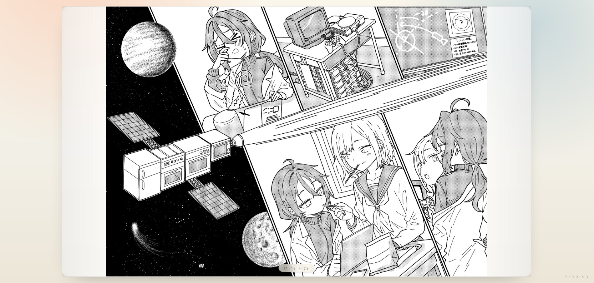

# SkyBind

Blueskyの漫画を見開きで読む&スレッドとして投稿するためのサービスです。

**https://skybind.blue/** で公開中

日本語 | [English](README.en.md)

---



SkyBindは、[Bluesky](https://bsky.app/)に投稿された漫画スレッドを見開き形式で読めるビューアです。
作者本人がBlueskyアカウントでログインし、自分のポストを指定すると、
`https://skybind.blue/v/xxxxxxxxxx` のような短いビューア用URLが発行されます。
リンクを開いた読者は見開きでページを読めます。

投稿を行っていない場合のための**アップローダー**も備えています。クライアント側での圧縮、1ポスト最大10枚ずつのスレッド分割、ビューア用URLの発行までまとめて行えるので、ページ数の多い漫画も快適にBlueskyに投稿できます。

簡単な紹介記事をブログに書いています:
https://tohu-sand.com/blog/2025-12-23/

## 仕組み

- ビューアはBlueskyの公開APIからスレッドをその場で取得して表示します。
  画像データをサーバーに保存・中継することはなく、データベースには最小限の
  メタデータ(リンクID・作者DID・ポストURI・タイトル・開き方向)だけを
  保持します。
- ビューア用リンクを作成できるのはポストの作者本人のみで、AT Protocol OAuth
  で確認します。OAuthトークンはブラウザ内にのみ保持され、サーバーには
  送信されません。
- アップローダーはブラウザからBlueskyへ直接投稿します。1ポストあたり最大
  10枚で自動的にスレッドへ分割し(5枚以上はギャラリー(カルーセル)embed、
  4枚以下は従来のグリッドembed)、Blueskyの2MB制限に収まるよう画像を
  クライアント側で圧縮します。
- 外部ページへの埋め込み用に `/embed/:id` ルートも用意しています。

## 構成

- フロントエンド: React + Vite + Tailwind CSS(`src/client/`)
- バックエンド: Cloudflare Pages Functions上のHono(`src/server/`、`functions/`)
- データベース: Cloudflare D1(`schema.sql`)
- 認証: AT Protocol OAuth(`@atproto/oauth-client-browser`)

## 開発

必要環境: Node.js 22、npm

```sh
npm install
cp .dev.vars.example .dev.vars

# クライアントのみの開発サーバー(APIなし)
npm run dev

# フルスタック: ビルドし、ローカルD1にスキーマを適用してwranglerで配信
npm run build
npm run db:apply
npx wrangler pages dev dist --port 8788
```

`127.0.0.1` からのログインはOAuthのループバッククライアントとして動作します。
アップロード(blobスコープ)を確実にテストするには
`cloudflared tunnel --url http://127.0.0.1:8788` などのトンネル経由でアクセスしてください。

## 自分のインスタンスを立てる

1. D1データベースを作成し(`npx wrangler d1 create skybind-db`)、そのIDを
   `wrangler.toml` に設定します。
2. `wrangler.toml` の `APP_URL` を自分のドメインに変更し、
   `public/client-metadata.json` 内の `https://skybind.blue` をすべて自分の
   ドメインに置き換えます。OAuthクライアントメタデータは `client_id` と
   完全に同じURLで配信されている必要があり、一致しないとアップローダーは
   動作しません。
3. スキーマを適用してデプロイします:

```sh
npm run db:apply:remote
npm run build
npm run deploy
```

## ライセンス

本プロジェクトは MIT ライセンスのもとで公開されています。詳細は [LICENSE](LICENSE) ファイルをご確認ください。

ただし、スクリーンショット(`docs/screenshot.jpg`)に含まれる漫画はMITライセンスの対象外です。この漫画の著作権は豆腐さんど(tohu_sand)に帰属し、無断での転載・再利用はできません。

利用している第三者ソフトウェア(@atproto/api, @atproto/oauth-client-browser, Hono, React, React Router, ウェブフォント)のライセンスは [THIRD_PARTY_LICENSES.md](THIRD_PARTY_LICENSES.md) をご確認ください。
